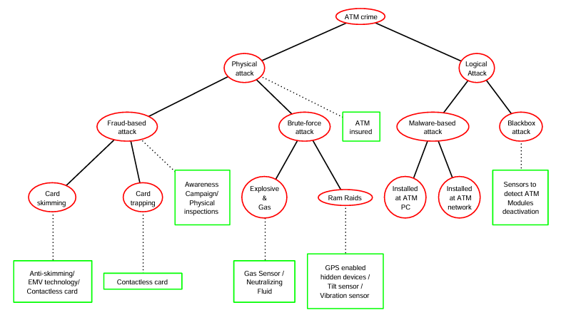

= Catálogo de Artefactos para el Modelado Seguro
:toc: left
:toclevels: 3
:sectnums:
:icons: font
:source-highlighter: rouge

== Introducción y contexto

=== Propósito
Este catálogo es un recurso práctico y metodológico diseñado para cualquier profesional de la industria, arquitecto de software, estudiante o entusiasta interesado en modelar y aplicar seguridad desde las fases iniciales del diseño de sistemas.

=== Prerrequisitos generales
Antes de utilizar este catálogo, el lector debe poseer conocimientos básicos en:
- Arquitectura de software (patrones, componentes y conectores).
- Lenguaje Unificado de Modelado (UML) básico.
- Conceptos de redes y flujo de datos.

=== Glosario de términos
- *Vulnerabilidad:* Debilidad en el sistema.
- *Amenaza:* Potencial explotación de una vulnerabilidad.
- *Mitigación:* Control diseñado para reducir el riesgo.

== Fundamentos de Modelado de Amenazas

=== El Manifiesto de Modelado de Amenazas
Todo proceso efectivo de modelado de amenazas debe centrarse en responder a las siguientes cuatro preguntas fundamentales:
1. ¿En qué estamos trabajando? (Análisis del sistema y la arquitectura).
2. ¿Qué puede salir mal? (Identificación de amenazas y vulnerabilidades).
3. ¿Qué vamos a hacer al respecto? (Definición de mitigaciones y controles).
4. ¿Hicimos un buen trabajo? (Validación, auditoría y retrospectiva).

=== El Modelo STRIDE
Marco de referencia utilizado para identificar amenazas categorizadas en: *S*poofing (Suplantación), *T*ampering (Manipulación), *R*epudiation (Repudio), *I*nformation Disclosure (Fuga de Información), *D*enial of Service (Denegación de Servicio) y *E*levation of Privilege (Elevación de Privilegios).

=== Matriz de Selección de Artefactos
La siguiente tabla indica qué artefacto utilizar según la categoría STRIDE a mitigar o descubrir.

[cols="3,1,1,1,1,1,1", options="header"]
|===
| Artefacto | S | T | R | I | D | E
| Attack Tree | | X | | | | X
| Data Flow Diagram (DFD) | X | X | | X | | X
| Misuse / Abuse Case | X | X | X | X | X | X
|===

== Catálogo de Artefactos

// Nota: Los artefactos se presentan en estricto orden alfabético.

// =============================================================================
// ARTEFACTO 3.1: ATTACK TREE
// =============================================================================

=== 3.1. Attack Tree (Árbol de Ataque)

==== 3.1.1. Contexto y propósito 
El *Attack Tree* (Árbol de Ataque) es un modelo conceptual y formal basado en grafos acíclicos dirigidos (DAG) que proporciona una descomposición sistemática, jerárquica y deductiva de los caminos potenciales mediante los cuales un adversario explota vulnerabilidades para vulnerar un sistema. Concebido formalmente en la literatura técnica por Bruce Schneier en 1999 como una evolución directa de los árboles de fallos (*Fault Trees*) de ingeniería de confiabilidad y de los *Threat Logic Trees*, el artefacto traduce metas abstractas de alto nivel en combinaciones de eventos atómicos cuantificables denominados *Basic Attack Steps* (BAS).

Dentro de la arquitectura de software seguro, un árbol de ataque trasciende la simple ilustración estática:
- **Semántica Formal y Descomposición:** Cada nodo representa una meta o submeta del adversario, estructurado formalmente como un álgebra de términos sobre un semirregistro idempotente distributivo. Las ramificaciones definen composiciones disyuntivas (*OR*, donde basta completar una alternativa) o conjuntivas (*AND*, donde deben satisfacerse todos los prerrequisitos hijos de forma complementaria).
- **Evaluación de Atributos (Bottom-Up):** Asigna valores a los nodos hoja (ej. costo monetario, tiempo de ejecución, probabilidad estocástica, requerimiento de equipo especial) y los sintetiza recursivamente hacia la raíz siguiendo las propiedades operacionales del dominio de atributos.
- **Análisis "What-If" y Toma de Decisiones:** Permite al arquitecto alterar valores paramétricos simulando la introducción de contramedidas o el incremento de barreras técnicas, observando el impacto matemático directo en el nodo raíz y podando (*pruning*) las rutas inviables para perfiles de atacantes específicos.
- **Captura y Reutilización de Conocimiento:** Funciona como un componente modular donde árboles completos (ej. vulneración de autenticación PGP o forzado físico) pueden acoplarse como subárboles dentro de modelos arquitectónicos de mayor escala.

*Alineación con el Modelo STRIDE:*
La evidencia empírica demuestra que el Attack Tree se alinea directamente con la taxonomía STRIDE al derivar sistemáticamente las condiciones que vulneran los objetivos de diseño:
- *Tampering (Manipulación):* Desglose minucioso de inyecciones de código (SQLi, manipulación de memoria, alteración de firmware de sensores IoT).
- *Elevation of Privilege (Elevación de Privilegios):* Modelado de escalada horizontal y vertical mediante secuencias de explotación de credenciales y derivación de tokens.
- *Spoofing (Suplantación):* Identificación de rutas de captura, robo o adivinación de credenciales (phishing, recolección de hashes, intercepción de sesiones).
- *Denial of Service (DoS):* Análisis de saturación de capas de transporte, enlace o aplicaciones en arquitecturas ciberfísicas y redes industriales.

==== 3.1.2. Contextos Metodológicos y Estándares Asociados
La adopción del Attack Tree en la ingeniería de software se sustenta en marcos formales y estándares consolidados:
- *Modelado de Amenazas Arquitectónico:* Guía metodológica del NCSC (*National Cyber Security Centre*), OWASP Threat Modeling Framework y LINDDUN (como formalismo de soporte a árboles de amenazas)
- *Ingeniería Basada en Modelos (MBSE / MDE):* Integración directa mediante metodologías como *MBSEsec* y *UMLsec*, permitiendo sintetizar árboles a partir de especificaciones formales como AADL (*Architecture Analysis & Design Language*) mediante herramientas de traducción automatizada como TAMSAT y evaluación de riesgo con SMART
- *Seguridad Ciberfísica e Industrial:* Cumplimiento de normativas críticas en automoción (ISO 21434, ISO 26262) y análisis de sistemas SCADA/OT donde la seguridad lógica (*security*) converge con la seguridad funcional (*safety*)
- *Bases de Conocimiento Estructuradas:* Correspondencia entre nodos hoja y catálogos estandarizados de vulnerabilidades y debilidades de MITRE (CAPEC y CWE)

==== 3.1.3. Dominios de Aplicación Tecnológica
El artefacto demuestra validez comprobada en diversas escalas arquitectónicas:
- *Sistemas Ciberfísicos (CPS) e Internet de las Cosas (IoT):* Modelado de intrusiones en cerraduras electrónicas inteligentes (ej. Amazon Key), plataformas médicas inteligentes como IGMIAS y redes de telemetría de Smart Hospitals frente a ataques dirigidos de inyección SQL y propagación lateral de malware.
- *Sistemas de Identidad y Repositorios de Credenciales Distribuidas:* Infraestructuras de red y Grid Computing, destacando el análisis formal del subsistema de certificados *MyProxy* en Globus Toolkit
- *Sistemas Financieros y Transaccionales:* Evaluación de fraude en cajeros automáticos (ATM Fraud) combinando vectores de ingeniería social, robo físico de plásticos, clonación (*skimming*) y software de intrusión en el dispensador.

[WARNING]
====
*Retos, Advertencias y Limitaciones (Principio Fail Fast)*

El diseñador debe conocer las restricciones técnicas del artefacto antes de comprometer esfuerzo en su construcción:

- *Explosión Combinatoria y Pérdida de Comprensibilidad:* En sistemas extensos, la descomposición recursiva manual deriva en grafos desproporcionados (efecto *hairball*). La literatura advierte que los árboles diseñados manualmente rara vez superan los 100 nodos sin volverse incomprensibles para los humanos si no intervienen herramientas de abstracción o poda matemática.
- *El Problema de los Clones (Nodos Repetidos):* Cuando un mismo paso de ataque atómico o credencial contribuye a múltiples ramas disyuntivas o conjuntivas (acciones clonadas), la evaluación ascendente clásica (*Bottom-Up*) falla matemáticamente al duplicar costos o distorsionar probabilidades. Resolverlo exige reformular el árbol como un Grafo Acíclico Dirigido (DAG) y recurrir a algoritmos de evaluación repetida o semántica de conjuntos (*Set Semantics*).
- *Incertidumbre y Subjetividad de Atributos:* Asignar valores estocásticos o financieros precisos a las hojas suele ser poco realista en fases tempranas de diseño. La literatura demuestra que las métricas de atacantes son inherentemente subjetivas y que datos históricos precisos rara vez están disponibles a nivel granular de exploits.
- *Ausencia de Dependencias Temporales Nativas:* La semántica básica AND/OR carece de mecanismos para modelar secuencias estrictas en el tiempo (ej. ejecutar *Paso 1* obligatoriamente antes de *Paso 2*), requiriendo extensiones no estandarizadas como compuertas secuenciales SAND (*Sequential AND*).
- *Naturaleza Unidireccional:* Modela exclusivamente las tácticas ofensivas, ignorando cómo las defensas mitigan dinámicamente cada paso intermedio, a menos que se extienda formalmente a un *Attack-Defense Tree*.
====

[IMPORTANT]
====
*Prerrequisitos de Diseño*

Para construir un árbol de ataque sólido y no un diagrama especulativo, el analista debe contar previamente con:
1. *Definición Explícita de la Meta Raíz:* Identificación precisa del activo de información de alto valor o el impacto que se busca evitar (ej. *"Exfiltrar base de datos clínica de pacientes"* o *"Robar fondos de cajero automático"*), evitando raíces ambiguas.
2. *Límites de Confianza y Superficie de Ataque:* Diagrama de Flujo de Datos (DFD) o diagrama de arquitectura que exponga claramente las fronteras de red, protocolos de comunicación, puntos de entrada públicos e interfaces expuestas.
3. *Definición de Perfiles de Amenaza:* Comprensión del nivel de habilidad técnica, presupuesto y acceso físico del adversario asumido (ej. atacante casual / *script-kiddie*, personal interno malicioso o amenazas persistentes avanzadas).
====

==== 3.1.4. Sintaxis Visual Oficial (Cómo se Dibuja)

La notación formal del Attack Tree está estandarizada en la literatura técnica y en herramientas formales (ADTool, SecurITree) bajo las siguientes reglas estructurales y geométricas:

[cols="1,2,2", options="header"]
|===
| Elemento Visual | Notación Gráfica y Simbología | Regla Semántica Estricta

| *Nodo Raíz (Meta Global)*
| Rectángulo o elipse (típicamente demarcado en rojo en herramientas formales) ubicado en la cúspide jerárquica del modelo.
| Solo puede existir un único nodo raíz activo por árbol o subescenario evaluado. Representa el estado final de compromiso alcanzado por el adversario

| *Compuerta OR (Refinamiento Disyuntivo)*
| Aristas directas simples que conectan el nodo padre con sus hijos, sin ningún símbolo adicional de cruce. (En algunas notaciones de ingeniería se rotula explícitamente "OR" en el conector)
| Refleja *alternativas independientes*. La meta del nodo padre se alcanza si *al menos uno* de los subobjetivos hijos se concreta con éxito. En síntesis matemática, un nodo OR adopta el valor de la ruta más barata (min) o más probable (max).

| *Compuerta AND (Refinamiento Conjuntivo)*
| Un arco curvo continuo que une y atraviesa transversalmente todas las líneas descendentes que conectan al padre con sus nodos hijos.
| Refleja *prerrequisitos complementarios obligatorios*. El atacante debe lograr *todos* los subobjetivos hijos para consumar la meta padre. En síntesis matemática, su costo corresponde a la suma de los hijos y su probabilidad al producto acumulado.

| *Compuerta SAND (Refinamiento Secuencial)*
| Un arco curvo que une las aristas acompañado de una flecha direccional que indica el orden de izquierda a derecha.
| Variante formalizada por Mauw, Jhawar et al. Exige que todas las acciones hijas se completen, pero respetando un orden temporal estricto (ej. autenticarse antes de inyectar comandos).

| *Nodos Hoja (BAS - Acciones Atómicas)*
| Nodos terminales (rectángulos o elipses sin descendencia).
| Representan vectores de ataque elementales que no requieren mayor refinamiento analítico. Son los únicos elementos a los que se les asignan directamente valores empíricos o de atributos.

| *Acciones Clonadas (Clones en DAG)*
| Múltiples referencias a un mismo nodo compartiendo idéntica etiqueta atómica dentro del grafo.
| Representan una misma instancia física o técnica que satisface múltiples metas simultáneas (ej. una campaña de phishing que otorga usuario y contraseña al mismo tiempo). Gráficamente deben fusionarse en un Grafo Acíclico Dirigido.
|===

==== 3.1.5. Guía de Construcción Paso a Paso (Algoritmo Metodológico)

La construcción rigurosa de un árbol de ataque se ejecuta mediante un ciclo estructurado de refinamiento recursivo (*top-down*), complementado por una propagación paramétrica (*bottom-up*):

. **Paso 1: Delimitación de la Meta Raíz (Attacker's Goal):**
   * Establecer una proposición concisa del objetivo hostil desde la mentalidad del atacante (ej. *"Comprometer repositorio de credenciales MyProxy"* o *"Abrir bóveda de seguridad"*). Este nodo se fija en la cúspide del lienzo.
. **Paso 2: Identificación de Superficies de Acceso Directas (Nivel 1):**
   * Descomponer la raíz en las rutas arquitectónicas generales de aproximación. En sistemas de software, estas submetas se mapean típicamente a los vectores de entrada principales: explotación de red, vulneración web/API, compromiso de almacenamiento o ingeniería social.
. **Paso 3: Determinación Estricta de Dependencias Lógicas (AND vs. OR):**
   * Para cada submeta, el arquitecto evalúa la necesidad operativa:
     * Si las opciones son sustitutos viables entre sí, se trazan como ramas disyuntivas (*OR*, sin arco)
     * Si el compromiso exige obligatoriamente la concurrencia de varios eventos técnicos (ej. obtener una cookie Y falsificar un encabezado), se enlazan mediante un arco continuo (*AND*).
. **Paso 4: Refinamiento Recursivo hasta Hojas Atómicas:**
   * Continuar desglosando cada subrama hacia abajo. 
   * **Criterio de parada (Regla del NCSC):** El refinamiento culmina cuando el nodo representa un paso operacional atómico (*Basic Attack Step*) que corresponde a una vulnerabilidad técnica conocida (CWE), un comando ejecutable, un vector físico o una técnica observable de red (ej. inyección SQL, intercepción ARP, fuerza bruta con diccionario) sin dependencias inferiores.
. **Paso 5: Identificación y Fusión de Clones en DAG:**
   * Detectar si una misma acción atómica se repite en distintas ramas del árbol. Fusionar los nodos redundantes compartiendo una misma entidad lógica para evitar incongruencias de cálculo.
. **Paso 6: Decoración y Asignación de Atributos:**
   * Asignar valores a los nodos hoja terminales. Pueden emplearse valores booleanos (*Posible/Imposible*, *Equipo especial requerido: Sí/No*) o métricas cuantitativas continuas extraídas de análisis de laboratorio o bases de riesgo (*Costo del ataque en USD*, *Probabilidad de éxito [0,1]*, *Tiempo en horas*).
. **Paso 7: Propagación Ascendente y Evaluación Matemática:**
   * Sintetizar el valor del nodo raíz aplicando las reglas formales de la semántica de atributos de Schneier y Mauw & Oostdijk:
[cols="1,2,2", options="header"]
|===
| Métrica / Atributo | Operador en Compuerta OR | Operador en Compuerta AND
| *Costo Financiero de Ataque* | min(C_1, C_2, ..., C_n) | Suma(C_1 + C_2 + ... + C_n)
| *Probabilidad de Éxito* | max(P_1, P_2, ..., P_n) | Producto(P_1 * P_2 * ... * P_n)
| *Tiempo Mínimo de Ejecución* | min(T_1, T_2, ..., T_n) | Suma(T_1 + T_2 + ... + T_n) (o max en paralelismo)
| *Habilidad Requerida* | min(Skill_1, ..., Skill_n) | max(Skill_1, ..., Skill_n)
|===
. **Paso 8: Simulación de Contramedidas y Poda ("What-If"):**
   * Identificar la ruta crítica más probable o de menor costo para el adversario. Simular la implementación de un control de seguridad arquitectónico alterando el valor de la hoja correspondiente (ej. elevando su costo de explotación al infinito) y recalculando el impacto en el nodo raíz para justificar el retorno de inversión en seguridad.

==== 3.1.6. Laboratorio: Caso de Estudio Aplicado

_Caso de Estudio: Compromiso de Repositorio de Credenciales MyProxy (Grid Computing) y Fraude en Cajeros Automáticos (ATM)_

Para validar la operatividad del modelo en arquitecturas complejas de software e infraestructuras críticas, se analiza la subestructura de ataque al portal web del servicio *MyProxy* en Globus Toolkit (Saini et al., 2008) combinada con el modelo estocástico de fraude en cajeros automáticos (Buldas et al., 2019):

*Análisis del Escenario de Software (MyProxy Web Portal):*
- **Meta Raíz:** *"Vulnerar la seguridad del repositorio MyProxy"*.
- **Descomposición:** El adversario evalúa cuatro vectores disyuntivos (OR): atacar el repositorio de almacenamiento, interceptar canales de transmisión, vulnerar los certificados x.509 o atacar el portal web.
- **Ruta Crítica en Portal Web:** Al centrarse en *"Atacar Web Portal"*, se descompone en comprometer el almacenamiento de certificados o romper la sesión de transmisión. Para *"Obtener Acceso Root en Almacenamiento"*, se requiere un ataque conjuntivo (AND): comprometer la llave maestra Y vulnerar el sistema operativo base.
- **Evaluación de Atributos de Ataque:**
[cols="2,2,2,2", options="header"]
|===
| Escenario de Ataque Modelado | Vector Técnico (BAS) | Costo para el Atacante (USD) | Costo de Daño al Negocio (USD)
| *Escenario 1 (Ruta Mínima)* | Ingeniería Social + Obtención de Credencial Root | $7,600 | $17,500
| *Escenario 2* | Soborno + Credencial Root | $8,500 | $17,500
| *Escenario 3* | Fuerza Bruta directa al canal web | $15,000 | $10,000
| *Escenario 4 (Máximo Esfuerzo)* | Fuerza Bruta combinada + Elevación Root | $22,500 | $25,000
|===
- **Conclusión Arquitectónica:** El análisis del árbol revela que fortalecer el cifrado o alargar las llaves criptográficas (ataque 3, $15,000 USD) ofrece un retorno de defensa marginal, ya que el adversario preferirá explotar la ingeniería social y las fallas de sanitización del portal web (ataque 1, $7,600 USD). El árbol orienta el presupuesto de diseño hacia mecanismos de autenticación multifactor (MFA) y sanitización estricta de parámetros.

==== 3.1.7. Herramientas de Software Recomendadas

Para trascender la diagramación manual en papel y habilitar la simulación cuantitativa formal, se recomiendan las siguientes herramientas:
- *ADTool / ADTool 2.0 (Universidad de Luxemburgo):* Entorno académico formal de código abierto diseñado específicamente para el diseño y cálculo cuantitativo ascendente de árboles de ataque y árboles de ataque-defensa mediante semántica de semirregistros y operadores personalizados.
- *SecurITree (Amenaza Technologies):* Solución industrial de modelado de amenazas basada en capacidades de adversarios. Permite asignar perfiles de atacantes, evaluar recursos y realizar poda algorítmica (*pruning*) de rutas inviables.
- *ATSYRA Studio / OSEAD:* Suites especializadas en modelado formal, extracción de estrategias óptimas y verificación de correctez de árboles mediante sistemas de transición y *model checking*.
- *Graphviz (DOT Language) / Cytoscape:* Bibliotecas de diagramación basadas en código (*Diagrams-as-Code*). Graphviz optimiza el trazado de grafos acíclicos dirigidos estáticos sin solapamiento de aristas; Cytoscape permite exploración interactiva y colapso dinámico de nodos en árboles que superan los 60 elementos.

==== 3.1.8. Checklist de Verificación y Auditoría (Criterio de Correctez)

Para comprobar que el diagrama fue construido con rigor metodológico y es formalmente correcto antes de pasar a la fase de implementación, el evaluador o estudiante debe auditar su modelo respondiendo a los siguientes criterios binarios:

[cols="1,2,2,2", options="header"]
|===
| Rubro Evaluado | Criterio de Verificación | Logrado (Condición Correcta) | No Logrado (Deficiencia Detectada)

| *Sintaxis y Notación (25%)*
| Diferenciación de compuertas lógicas y directrices de conexión.
| Todas las compuertas conjuntivas (AND) están claramente identificadas mediante arcos transversales continuos; las disyunciones (OR) usan líneas directas simples sin adornos.
| Uso ambiguo de conectores sin arcos ni etiquetas, forzando al lector a adivinar la relación lógica entre submetas.

| *Topología del Grafo (25%)*
| Integridad estructural y aciclicidad.
| El árbol presenta una única raíz superior, fluye unidireccionalmente de arriba a abajo y carece de ciclos lógicos cerrados (cumple la regla formal de DAG)
| Presencia de lazos o nodos hijos que apuntan de regreso a nodos ancestros; múltiples raíces inconexas en el mismo grafo

| *Nivel de Abstracción en Hojas (25%)*
| Atomicidad técnica de los nodos terminales (BAS).
| Todos los nodos hoja representan acciones técnicas elementales y observables en el sistema (ej. inyección de payload, robo de cookie, fuerza bruta) que no requieren subdivisión
| Existen hojas que siguen siendo metas abstractas de alto nivel (ej. *"Romper la seguridad del servidor"*, *"Hacer trampa"*) sin vector técnico observable

| *Consistencia Cuantitativa (25%)*
| Sintaxis de propagación ascendente y manejo de clones.
| Los valores de las hojas se combinan en las compuertas respetando el álgebra de semirregistros (AND suma costos/multiplica probabilidades; OR toma mínimos/máximos); los nodos repetidos se tratan como clones para no distorsionar el cálculo
| Se suman costos en compuertas disyuntivas OR; existen nodos hoja sin valores asignados o los clones se evalúan como eventos físicamente independientes duplicando costos erróneamente
|===

==== 3.1.9. Recursos y Lecturas Recomendadas
- *Artículo Seminal Original:* Schneier, B. (1999). _Attack Trees: Modeling security threats_. Dr. Dobb's Journal, 24(12), 21-29
- *Fundamentación Matemática y Semántica Formal:* Mauw, S., & Oostdijk, M. (2005). _Foundations of Attack Trees_. International Conference on Information Security and Cryptology (ICISC 2005), LNCS 3935, pp. 186-198
- *Tratamiento de Clones e Información Incompleta:* Buldas, A., Gadyatskaya, O., Mauw, S., Lenin, A., & Trujillo-Rasua, R. (2019). _Attribute Evaluation on Attack Trees with Incomplete Information_. Computers & Security / arXiv:1812.10754
- *Análisis Formal y Tesis Doctoral:* Wideł, W. (2019). _Formal modeling and quantitative analysis of security using attack-defense trees_. Université Bretagne Loire / INSA Rennes.
- *Casos Prácticos en Software Distribuido:* Saini, V., Duan, Q., & Paruchuri, V. (2008). _Threat Modeling Using Attack Trees (MyProxy Case Study)_. Journal of Computing Sciences in Colleges, 23(4), 124-131
- *Tutoriales y Guías Técnicas de la Industria:* NCSC UK (2023). _Using attack trees to understand cyber security risk_. National Cyber Security Centre.

// ---------------------------------------------------------
// ARTEFACTO 3.2: DATA FLOW DIAGRAM (DFD) ENFOCADO A AMENAZAS
// ---------------------------------------------------------
=== 3.2. Data Flow Diagram (DFD)
_(Estructura idéntica...)_

// ---------------------------------------------------------
// ARTEFACTO 3.3: MISUSE / ABUSE CASE
// ---------------------------------------------------------
=== 3.3. Misuse / Abuse Case
_(Estructura idéntica...)_