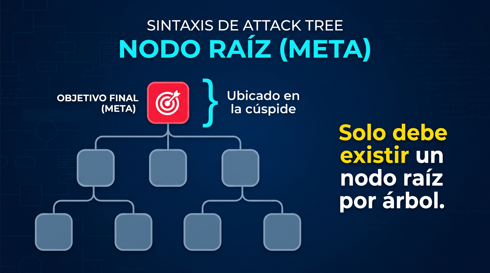
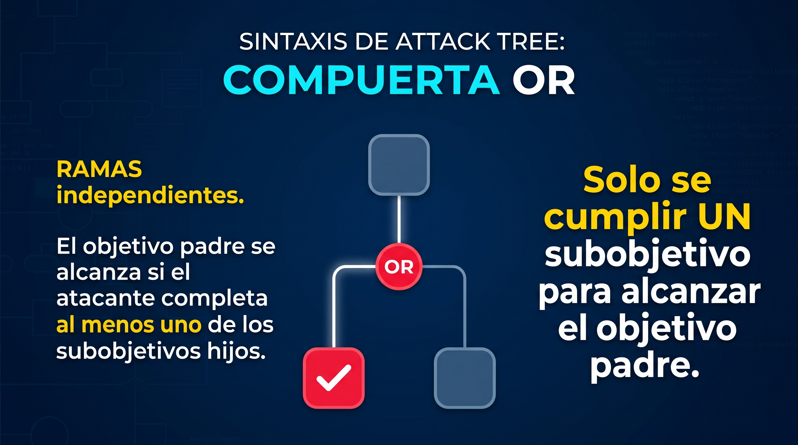
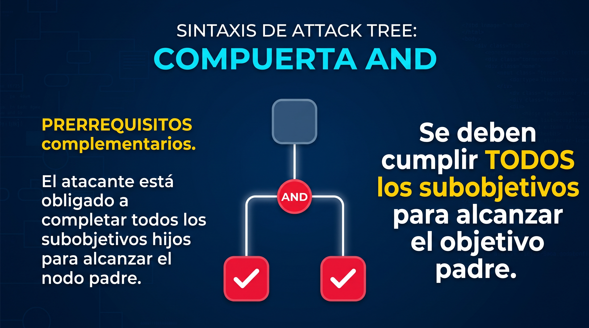
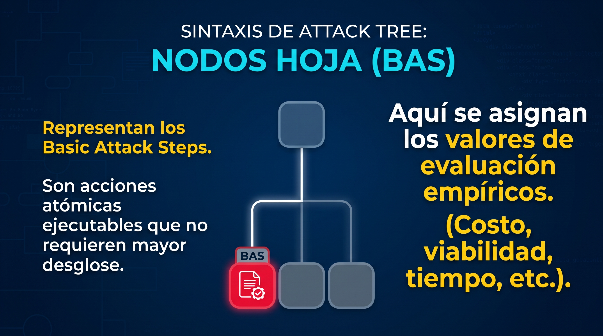
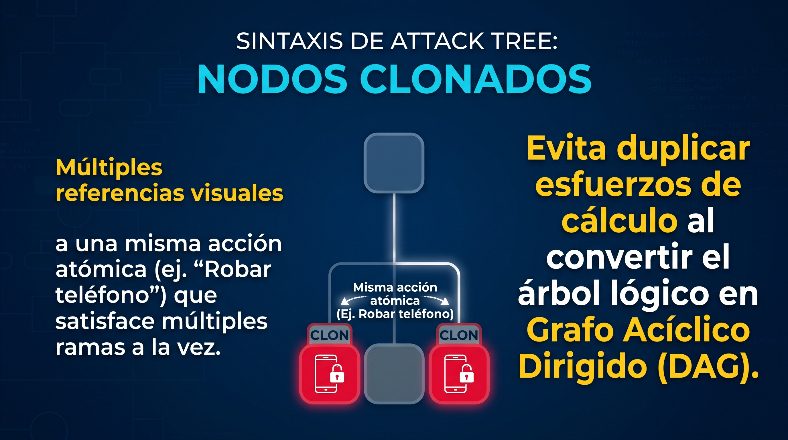
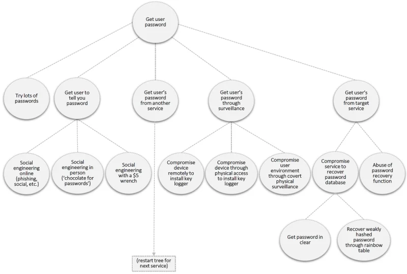

= Catálogo de Artefactos de Diseño para el Modelado Seguro
:toc: left
:toclevels: 3
:sectnums:
:source-highlighter: rouge

== Introducción

=== Propósito del catálogo
En la Ingeniería de Software contemporánea, la seguridad no puede considerarse un atributo implícito ni una capa añadida en etapas de producción. La evidencia señala que aproximadamente el 50% de las vulnerabilidades en los sistemas tienen su origen en deficiencias a nivel de diseño. Sin embargo, existe una brecha de conocimiento que provoca que el modelado seguro sea omitido debido a la complejidad de las herramientas y la alta dependencia del juicio de expertos.

Este catálogo es un recurso de referencia estructurado que busca resolver este problema de toma de decisiones. Su contenido y directrices no son arbitrarios; han sido construidos bajo la metodología *Design Science Research Methodology (DSRM)*. Los artefactos aquí presentados han sido sintetizados a partir de una Revisión Sistemática de la Literatura (RSL), la cual filtró más de 770 estudios para seleccionar los 39 artefactos más vigentes y validados de la última década, además de ser complementada con literatura gris y documentación técnica oficial de la industria.

=== Uso previsto
Este catálogo está diseñado como una herramienta de consulta específica y no como un documento de lectura secuencial. El usuario debe identificar primero la amenaza que su sistema enfrenta, consultar la Matriz de selección de artefactos para determinar qué modelo gráfico utilizar, y dirigirse directamente a la sección correspondiente para aplicar las reglas de diseño y mitigación de dicho artefacto.

=== Alcances y limitaciones
Para facilitar la correcta aplicación de este catálogo, se delimita su entorno de uso:

* *Alcances:* 
** Se enfoca exclusivamente en la etapa de diseño y arquitectura de software.
** Proporciona la sintaxis visual, guías de construcción y checklists de auditoría para los artefactos de seguridad con mayor nivel de adopción en el modelado seguro.
** Clasifica y aborda las amenazas basándose  en la taxonomía STRIDE.

* *Limitaciones:*
** No aborda la implementación a nivel de código fuente, configuraciones de infraestructura de red ni despliegue de servidores.
** No incluye validaciones empíricas del software final; su correcta aplicación reduce los riesgos arquitectónicos, pero no sustituye las auditorías formales por parte de especialistas en ciberseguridad ni garantiza la invulnerabilidad total del sistema.

=== Prerrequisitos
Para aprovechar al máximo este catálogo, el lector debe contar con las siguientes bases:

. *Conocimientos técnicos:*
** Comprensión del Ciclo de Vida del Desarrollo de Software (SDLC).
** Diseño de software básico (patrones, componentes, conectores, etc.).
** Fundamentos del Lenguaje Unificado de Modelado (UML) y flujo de datos.
. *Enfoque y actitud:*
** Pensamiento orientado al adversario, es decir, el lector debe asumir que el sistema será atacado.
** Compromiso con la integración de la seguridad como un atributo de calidad desde la concepción del sistema, y no como un parche posterior.

=== Glosario
En ciberseguridad, es común el uso de términos que, aunque parecen similares, tienen significados distintos. Para garantizar la consistencia en el modelado, se establecen las siguientes definiciones formales basadas en la literatura:

* *Vulnerabilidad:* Falla, debilidad o imperfección técnica en el diseño, la arquitectura o el código del sistema que abre la puerta a un vector de ataque. La fase de diseño es la más susceptible a generar estas debilidades [1].
* *Amenaza:* Cualquier individuo, circunstancia o acción que tenga la capacidad y la intención de aprovechar una vulnerabilidad existente en un sistema para producir un impacto adverso [2].
* *Ataque y Atacante:* El ataque se define como la acción ofensiva contra la ciberinfraestructura de un objetivo. El atacante es la entidad adversaria (activa o pasiva) que ejecuta la acción buscando violar las garantías de seguridad [2], [3].
* *Riesgo:* La posibilidad estructurada de que acciones o eventos humanos conduzcan a resultados no deseados que afecten entidades de valor. Se fundamenta en calcular la probabilidad de que ocurra un evento adverso y el impacto negativo que este tendría [3].
* *Mitigación:* Enfoque proactivo centrado en gestionar el comportamiento del software para limitar daños, proporcionar continuidad y prevenir accesos o modificaciones no autorizadas, reduciendo así el riesgo [4].

== Fundamentos de Modelado de Amenazas

El modelado de amenazas es un proceso estructurado utilizado para identificar, analizar y comprender los vectores de riesgo que pueden afectar a un sistema o aplicación. Su propósito principal es evaluar riesgos de seguridad de manera anticipada y definir contramedidas de diseño antes de la etapa de implementación [5].

=== El Manifiesto de Modelado de Amenazas
Para que el modelado de amenazas no se convierta en un ejercicio conceptual abstracto, debe ser guiado por un proceso. El marco metodológico de Shostack, adoptado por OWASP, estructura esta actividad en cuatro preguntas fundamentales que el equipo de diseño debe responder iterativamente [6]:

1. *¿En qué estamos trabajando?*
El punto de partida exige delimitar el alcance del modelo. Los arquitectos y el equipo técnico deben comprender la topología del sistema. Para responder a esta pregunta, se generan entradas como diagramas de arquitectura, diagramas de flujo de datos (DFD) o clasificaciones de datos, las cuales definen las fronteras de confianza del sistema.
2. *¿Qué puede salir mal?*
Constituye la fase de investigación activa para descubrir las amenazas aplicables al sistema modelado. Dado que una discusión abierta puede carecer de foco, se requiere utilizar metodologías estructuradas (como STRIDE, LINDDUN, PASTA o CAPEC) que obliguen a los diseñadores a evaluar sistemáticamente la superficie de ataque y los vectores de vulnerabilidad.
3. *¿Qué vamos a hacer al respecto?*
En esta etapa, los hallazgos técnicos se traducen en acciones arquitectónicas específicas. Para cada amenaza identificada, el diseñador debe evaluar y aplicar una estrategia de remediación adecuada: Transferir, Evitar, Mitigar o Eliminar el riesgo. Aquí es donde se justifican y aplican los artefactos de diseño seguro.
4. *¿Hicimos un trabajo lo suficientemente bueno?*
La fase de cierre. Consiste en una actividad retrospectiva en la que se audita el trabajo realizado para verificar la calidad, la viabilidad de las soluciones propuestas y confirmar que las mitigaciones no hayan introducido nuevas vulnerabilidades al sistema.

=== El Modelo STRIDE
Desarrollado originalmente por Microsoft y adoptado ampliamente en la industria, STRIDE es un marco de referencia maduro para el modelado de amenazas. Su función es proporcionar una estructura mental que permita a los arquitectos pensar como un atacante y categorizar los fallos de seguridad potenciales [6]. 

Las categorías de STRIDE y las propiedades de seguridad que buscan vulnerar son:

* *S - Spoofing (Suplantación de identidad):* Acción maliciosa orientada a hacerse pasar por una entidad, usuario o sistema distinto para obtener acceso no autorizado a los recursos. Afecta directamente la propiedad de autenticación.
* *T - Tampering (Manipulación):* Modificación maliciosa y no autorizada de datos, ya sea en tránsito a través de la red o en reposo (bases de datos), alterando la integridad de la información.
* *R - Repudiation (Repudio):* Capacidad de un usuario o atacante de negar haber realizado una acción en el sistema debido a la falta de capacidad del sistema para demostrar lo contrario. Vulneración del no repudio.
* *I - Information Disclosure (Divulgación de información):* Fuga o acceso no autorizado a datos confidenciales, originada por espionaje de redes o fallos de protección de acceso. Compromete directamente la Confidencialidad.
* *D - Denial of Service (Denegación de Servicio):* Intento de degradar, saturar o impedir que un sistema, recurso o red esté disponible para sus usuarios legítimos. Afecta la disponibilidad.
* *E - Elevation of Privilege (Elevación de Privilegios):* Explotación de un fallo que permite a un atacante obtener permisos de acceso superiores a los concedidos, facilitando la ejecución de acciones no autorizadas. Afecta directamente la autorización.

=== Matriz de selección de artefactos
La siguiente tabla indica qué artefacto gráfico es el más adecuado para identificar, analizar o diseñar mitigaciones según la categoría de amenaza STRIDE que se desea abordar en el sistema.

[cols="3,1,1,1,1,1,1", options="header"]
|===
| Artefacto | S | T | R | I | D | E
| Attack Tree | | X | | | | X
| Data Flow Diagram (DFD) | X | X | | X | | X
| Misuse / Abuse Case | X | X | X | X | X | X
|===

= Listado de artefactos

== Attack Tree - Árbol de Ataque

=== Propósito y contexto
El Attack Tree es un modelo conceptual basado en grafos que proporciona una representación visual, estructurada y metódica de los diferentes caminos que un atacante puede seguir para vulnerar un sistema. Concebido originalmente como una adaptación de los árboles de fallos (véase más adelante _Fault Trees_) de la ingeniería de confiabilidad, este artefacto traduce un objetivo hostil abstracto en el nodo raíz y lo descompone jerárquicamente en subobjetivos hasta llegar a acciones atómicas elementales en los nodos hoja.

Dentro del diseño de software, funciona como una herramienta analítica y de comunicación. Permite a los diseñadores pensar desde la perspectiva del adversario, evaluar la viabilidad de distintas rutas de ataque basándose en atributos como el costo, dificultad o probabilidad, e identificar con precisión en qué puntos de la arquitectura es más efectivo implementar controles y contramedidas.

=== Contextos metodológicos y estándares asociados
La adopción de este artefacto no ocurre de forma aislada; la literatura demuestra que su eficacia radica en su integración con marcos y normativas consolidadas:

- *Marcos de modelado de amenazas:* Integración directa con metodologías como STRIDE para categorizar vulnerabilidades, así como el uso de bases de conocimiento estandarizadas como CAPEC y la matriz MITRE ATT&CK [7], [8].
- *Ingeniería basada en modelos:* Su generación y análisis se incorporan en metodologías formales como MBSEsec y UMLsec para evaluar la seguridad directamente desde los modelos arquitectónicos del sistema [9], [10].
- *Bases de conocimiento específicas:* Apoyo en marcos como Misuse Activities (MUA) y Mobile Application Security Testing (MAST) para la identificación estructurada de amenazas [11].

=== Dominios de aplicación y de software
El artefacto demuestra una alta versatilidad, aplicándose en arquitecturas donde las fallas de seguridad tienen impactos críticos:

- *Sistemas ciberfísicos (CPS) e IoT:* Evaluación de riesgos en infraestructuras interconectadas, desde hogares inteligentes hasta monitores médicos, donde las vulnerabilidades lógicas derivan en daños físicos [10], [12].
- *Sector automotriz y vehicular:* Modelado de seguridad en vehículos modulares e interconectados, evaluando múltiples combinaciones de ciberseguridad ante reconfiguraciones constantes [9].
- *Redes y sistemas críticos:* Análisis de amenazas en Redes Definidas por Software (SDN) y protección de infraestructuras críticas como sistemas de alerta temprana [7], [11].
- *Aplicaciones web:* Mitigación de inyecciones de código e intercepción de datos en etapas tempranas del ciclo de vida del desarrollo [14].

[WARNING]
====
*Retos y limitaciones del artefacto*

Antes de comprometer recursos en la construcción de un árbol de ataque, el diseñador debe considerar los siguientes desafíos y limitantes reportadas en la industria:

- *Alta complejidad de modelado:* Trazar todos los vectores posibles resulta cognitivamente demandante. En sistemas extensos, el modelo puede crecer desproporcionadamente, requiriendo herramientas de visualización interactiva para mantener su legibilidad.
- *Dependencia de expertos:* Construir un modelo exhaustivo exige habilidades de análisis y un conocimiento profundo del dominio (bases de vulnerabilidades, tácticas de adversarios) que el desarrollador promedio no suele poseer de forma nativa [10], [13].
- *Subjetividad en atributos:* Asignar valores precisos (como la probabilidad de éxito o el costo exacto de un ataque) a los nodos hoja es un reto. Los datos históricos estadísticos suelen ser escasos, lo que introduce un nivel de incertidumbre en las evaluaciones [10].
- *Cobertura incompleta:* El árbol modela lo que el analista conoce. Vulnerabilidades de día cero o vectores no documentados quedarán fuera del modelo, por lo que nunca debe asumirse que el sistema es 100% seguro [12].
====

[IMPORTANT]
====
*Prerrequisitos de diseño*

Para que el diagrama sea útil en la práctica y no se base únicamente en suposiciones, el equipo debe definir previamente:

1. *El objetivo del atacante:* Tener mucha claridad sobre el activo crítico a proteger (ej. "Robar credenciales de usuario" o "Saturar el servidor web").
2. *Superficie de ataque:* Comprensión topológica del sistema (idealmente a través de un DFD) para conocer los límites de confianza y los puntos de entrada expuestos.
3. *Perfil del adversario:* Determinar si se evalúa a un atacante casual, un empleado interno malicioso o una amenaza persistente avanzada (APT), ya que esto dictará qué rutas del árbol son viables.
====

=== Sintaxis visual oficial

_Nota: La notación gráfica de los árboles de ataque no cuenta con un estándar universal único; las formas pueden variar según la herramienta de software utilizada. Sin embargo, la lógica estructural se mantiene constante bajo las siguientes reglas semánticas:_

* *Nodo raíz (Meta):*
Ubicado en la cúspide. Representa el objetivo final del adversario. Solo debe existir un nodo raíz por árbol.
+

* *Compuerta OR:*
Ramas independientes. El objetivo padre se alcanza si el atacante completa al menos uno de los subobjetivos hijos.
+

* *Compuerta AND:*
Prerrequisitos complementarios. El atacante está obligado a completar *todos* los subobjetivos hijos (usualmente indicados con un arco que une las líneas descendentes) para alcanzar el nodo padre.
+

* *Nodos hoja (BAS):*
Representan los _Basic Attack Steps_. Son acciones atómicas ejecutables que no requieren mayor desglose. Aquí se asignan los valores de evaluación empíricos (costo, viabilidad, tiempo, etc.).
+

* *Nodos clonados (Opcional en modelos avanzados):*
Múltiples referencias visuales a una misma acción atómica (ej. "Robar teléfono") que satisface múltiples ramas a la vez. Convierte el árbol lógico en un Grafo Acíclico Dirigido (DAG) para evitar duplicar esfuerzos de cálculo.
+

=== Guía de construcción paso a paso

El diseño de un árbol de ataque sigue un proceso iterativo de refinamiento descendente, finalizando con un análisis ascendente:

. *Definir el nodo raíz:* Identificar el objetivo principal desde la perspectiva del atacante. Este debe ser un objetivo accionable y específico (ej. "Vulnerar servidor de base de datos").
. *Identificar rutas de acceso (sub-metas):* Desglosar el objetivo principal en los enfoques generales que el atacante podría tomar (ej. ataque de red, ataque físico, ingeniería social).
. *Estructurar la lógica (AND / OR):* Para cada ruta, determinar las dependencias:
  * Si el atacante tiene varias alternativas independientes para lograr el paso, conectarlas como ramas disyuntivas (*OR*).
  * Si el atacante requiere completar múltiples pasos obligatorios en conjunto, conectarlas como ramas conjuntivas (*AND*).
. *Refinar hasta nodos hoja:* Continuar subdividiendo los enfoques hasta alcanzar acciones atómicas observables (técnicas de explotación específicas, robo físico, phishing) que ya no necesiten desglose.
. *Asignar atributos a las hojas:* Evaluar los nodos terminales asignando métricas según el perfil del atacante (ej. Nivel de habilidad técnica requerida, costo monetario, equipo especial necesario, probabilidad de éxito).
. *Evaluar y priorizar:* Analizar el árbol desde las hojas hacia la raíz para descubrir la ruta de menor resistencia (ej. el ataque más barato o el más probable). 
. *Integrar contramedidas:* Identificar en qué nodos críticos se pueden insertar defensas arquitectónicas para romper las rutas conjuntas (AND) o elevar el costo/dificultad de las rutas disyuntivas (OR) más viables.

=== Ejemplo de caso de estudio aplicado

Para comprender la utilidad práctica del Attack Tree, es fundamental establecer primero el contexto del sistema y el perfil de la amenaza antes de comenzar a dibujar nodos. Como establece el Centro Nacional de Seguridad Cibernética (NCSC) del Reino Unido en su evaluación de infraestructuras críticas, la seguridad no es un interruptor binario que simplemente se enciende o se apaga; es una escala dinámica que depende de qué activos se valoran más y contra quién se están defendiendo [15].

Antes de trazar el árbol, el equipo de diseño debe definir el modelo de amenaza. Los perfiles de atacantes pueden abarcar desde estados hostiles patrocinados, hasta el crimen organizado o estafadores comunes [15]. Asimismo, las intenciones hostiles suelen clasificarse en categorías de alto nivel, tales como el espionaje (robo o corrupción de datos), la interrupción (detener el servicio de la red), o el pre-posicionamiento (obtener acceso silencioso a los sistemas administrativos para un uso futuro) [15].

Para este caso de estudio, nos enfocaremos en el vector del compromiso de las credenciales de un usuario. El siguiente diagrama ilustra cómo este objetivo abstracto se descompone en acciones tangibles, abarcando desde vulnerabilidades de software hasta el clásico escenario de coerción física (conocido en la industria como el ataque de la "llave inglesa de $5") [15].

*Aplicación del algoritmo de construcción:*

* *Paso 1. Definir el nodo raíz:* Tras evaluar las prioridades de seguridad, el equipo establece el objetivo central del adversario en la cúspide del modelo: _"Obtener la contraseña del usuario"_.
* *Paso 2. Identificar rutas de acceso (sub-metas):* El analista descompone el objetivo en cinco vectores principales de aproximación: adivinar contraseñas iterativamente, lograr que el usuario la revele, obtenerla desde otro servicio vulnerado, extraerla mediante vigilancia física/lógica, o comprometer directamente el servicio objetivo.
* *Paso 3. Estructurar la lógica (AND / OR):* Dado que estas cinco sub-metas son vías completamente independientes y el atacante solo necesita tener éxito en una de ellas para obtener la contraseña, se enlazan al nodo raíz mediante compuertas disyuntivas (*OR*).
* *Paso 4. Refinar hasta nodos hoja (BAS):* Se toma la sub-meta _"Lograr que el usuario revele la contraseña"_ y se desglosa recursivamente. Esto deriva en tres nodos terminales u hojas atómicas conectadas por una compuerta *OR*: ingeniería social en línea (phishing), ingeniería social en persona (soborno), e ingeniería social con amenaza física (la llave inglesa de $5) [15].
* *Paso 5. Asignar atributos a las hojas:* Se evalúa el riesgo y costo de cada BAS. Por ejemplo, una campaña de _phishing_ automatizada requiere un bajo costo financiero y permite un ataque a gran escala. Por el contrario, la coerción física representa una alta efectividad, pero conlleva un altísimo costo logístico y un riesgo legal/físico que solo un actor de amenaza muy motivado o crimen organizado estaría dispuesto a asumir.
* *Paso 6. Evaluar y priorizar:* El análisis ascendente (*bottom-up*) revela que las rutas de menor resistencia para un atacante remoto promedio son el _phishing_ o el abuso de funciones de recuperación de contraseñas mal diseñadas. 
* *Paso 7. Integrar contramedidas:* Basado en esta evidencia, el diseño de la arquitectura asume que las contraseñas eventualmente serán reveladas o robadas, independientemente de las políticas de longitud o complejidad. Esto justifica económicamente la necesidad de implementar controles arquitectónicos robustos como la Autenticación Multifactor (MFA) y el monitoreo de anomalías en el plano de gestión, invalidando la utilidad de la contraseña como único factor de acceso [15].

=== Herramientas de software recomendadas

Para gestionar la escalabilidad y aplicar análisis cualitativos o cuantitativos, se recomienda trascender el dibujo manual mediante las siguientes herramientas:

- *Devici / IriusRisk / SecurITree:* Plataformas comerciales especializadas en modelado continuo de amenazas que permiten definir perfiles de atacantes, evaluar recursos y eliminar automáticamente rutas de ataque irrelevantes o inviables.
- *Cytoscape / GraphViz:* Bibliotecas de visualización de grafos (Diagrams-as-Code) que permiten renderizar programáticamente estructuras complejas mediante notación DOT, ideales para integrar árboles en repositorios de código.
- *OWASP Threat Dragon / Microsoft Threat Modeling Tool:* Herramientas gratuitas orientadas a desarrolladores para generar modelos tempranos de amenazas.

=== Checklist de verificación y auditoría

Audite el árbol de ataque respondiendo a los siguientes criterios binarios antes de dar por finalizada la fase de modelado:

[cols="1,2,2", options="header"]
|===
| Rubro evaluado | Logrado | No Logrado

| *Enfoque del objetivo*
| El árbol posee un único nodo raíz claramente definido como un estado de compromiso u objetivo hostil específico.
| El árbol presenta múltiples nodos raíz desconectados o el objetivo es ambiguo (ej. "Falla del sistema" en lugar de "Robo de base de datos").

| *Coherencia lógica (AND/OR)*
| La diferencia entre alternativas independientes (OR) y pasos secuenciales obligatorios (AND) está gráficamente clara y lógicamente justificada.
| Se etiquetan pasos obligatorios como alternativas, asumiendo que el atacante logra la meta sin completar la cadena necesaria.

| *Atomicidad de las hojas (BAS)*
| Los nodos terminales representan acciones técnicas o físicas ejecutables y evaluables directamente sin ambigüedad.
| Los nodos hoja siguen siendo conceptos abstractos de alto nivel que no indican cómo se ejecuta el ataque.

| *Ausencia de ciclos (Aciclicidad)*
| El diagrama fluye en una sola dirección hacia la meta, estructurándose como un Grafo Acíclico Dirigido (DAG).
| Existen bucles lógicos donde un paso de ataque requiere la finalización de un paso superior, creando un ciclo infinito.
|===

=== Recursos y lecturas recomendadas
- *Artículo seminal:* Schneier, B. (1999). _Attack Trees: Modeling security threats_. Dr. Dobb's Journal.
- *Guías técnicas de la industria:* NCSC UK. _Using attack trees to understand cyber security risk_. National Cyber Security Centre.
- *Caso de estudio gubernamental:* I. Levy (2020). The future of telecoms in the UK. NCSC Blog [15].
- *Metodologías prácticas:* DevSecOps. _Guide to Threat Modeling using Attack Trees_.
- *Video tutorial:* _Attack Tree Analysis: How to use it for Threat Modeling. https://www.youtube.com/watch?v=2nxPm_1lS0g_.

== Referencias (Añadidas a las existentes)

[1] S. Rehman y K. Mustafa, "Research on software design level security vulnerabilities", ACM SIGSOFT Software Engineering Notes, vol. 34, no. 6, pp. 1–5, 2009. https://doi.org/10.1145/1640162.1640171

[2] R. Derbyshire, B. Green, D. Prince, A. Mauthe, y D. Hutchison, "An Analysis of Cyber Security Attack Taxonomies", Proceedings - 3rd IEEE European Symposium on Security and Privacy Workshops, EURO S and PW 2018, pp. 153–161, 2018. https://doi.org/10.1109/EuroSPW.2018.00028

[3] CyBOK, The Cyber Security Body of Knowledge. 2021.

[4] H. Washizaki (Ed.), Guide to the Software Engineering Body of Knowledge (SWEBOK Guide) Version 4.0 (4th ed.), IEEE Computer Society, 2024.

[5] OWASP, "Thread Modeling", 2025. [Online]. Disponible en: https://owasp.org/www-community/Threat_Modeling

[6] OWASP, "Threat Modeling Manifesto", 2025.

[7] Y. Yang et al., "Network security analyzing and modeling based on Petri net and Attack tree for SDN," 2016 IEEE International Conference on Computing, Networking and Communications (ICNC), 2016.

[8] X. Chen et al., "An approach to generating attack graphs and analyzing threats based on CAPEC and ATT&CK matrix," Springer, 2025.

[9] S. Paul et al., "Model-based Attack Tree Generation for Cybersecurity Risk-Assessments in Automotive," 2021 IEEE International Symposium on Systems Engineering (ISSE), 2021.

[10] O. Gadyatskaya et al., "Quantitative Cybersecurity Analysis Framework for Cyber Physical Systems: A Conceptual Approach," IEEE Open Journal of the Computer Society, 2025.

[11] M. Fraile et al., "Mitigating security threats using tactics and patterns: a controlled experiment," ACM Digital Library, 2016.

[12] J. Doe et al., "A framework for evaluating security risk in system design," SpringerLink, 2022.

[13] S. Mauw et al., "A Study of Security Modeling Techniques for Smart Systems," 2019 IEEE, 2019.

[14] A. Author et al., "Modeling a SQL injection attack," IEEE Xplore, 2016.

[15] I. Levy, "The future of telecoms in the UK," National Cyber Security Centre (NCSC), Ene. 2020. [Online]. Disponible en: https://www.ncsc.gov.uk/blog-post/the-future-of-telecoms-in-the-uk